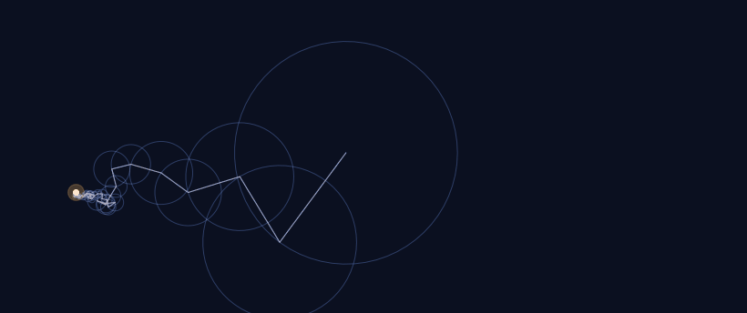
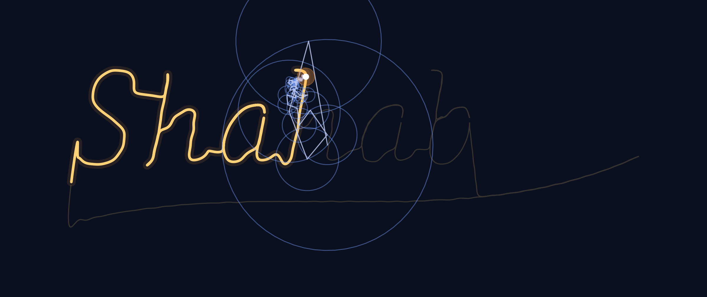
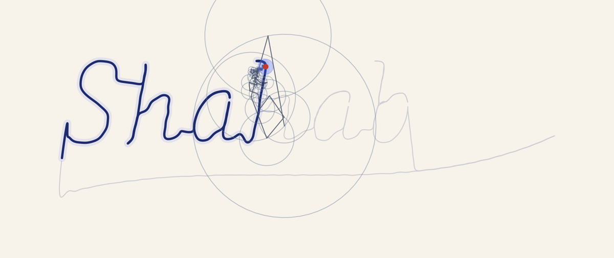
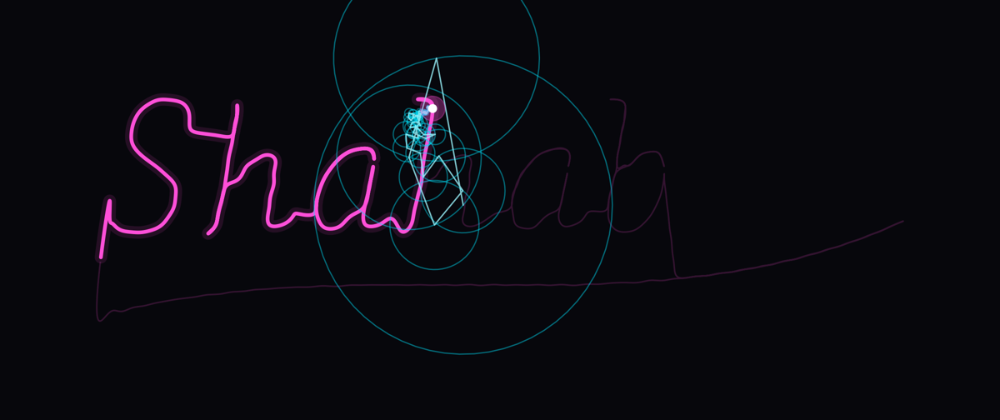

<div align="center">

# Fourier Signature

Your signature, redrawn by rotating circles.



[](https://www.python.org/)
[](LICENSE)
[](tests/)

</div>

Fourier Signature turns a handwritten signature into a chain of spinning circles (epicycles) that redraw it stroke by stroke. Give it a photo or scan of a signature, or draw one in the browser, and export the result as an animated GIF, an MP4 video, a looping animated SVG (perfect for an email signature or a slide intro) or a high resolution poster.

It is a small, honest piece of mathematics made visible: the discrete Fourier transform, Parseval's theorem and least squares approximation, all in one picture.

## Highlights

- Image in, animation out. PNG, JPG, scans and phone photos, dark ink on light paper or the reverse, transparent PNGs too.
- A pen that follows the ink. Strokes are skeletonised and walked as a graph (an Euler tour per stroke), so the circles trace each letter instead of zigzagging between random pixels.
- Four outputs: GIF, MP4, animated SVG with real epicycles (no JavaScript, loops forever) and print quality PNG posters.
- Three themes: midnight, paper and neon.
- Browser drawing pad in a single HTML file: sign with mouse, pen or finger and watch it play instantly.
- Clean Python API and a one line command line tool.

## Quick start

```bash
git clone https://github.com/001shahab/FourierSignature.git
cd FourierSignature
python -m venv .venv && source .venv/bin/activate
pip install -r requirements.txt

python -m fourier_signature examples/signature.png -o out/signature.gif --svg out/signature.svg --poster out/poster.png
```

Or install it as a command:

```bash
pip install .
fourier-signature my_signature.jpg -o my_signature.gif --circles 250 --theme neon
```

## The drawing pad

Open `web/index.html` in any modern browser. No server and no install are needed.

1. Sign in the canvas (several strokes are fine).
2. Press Play and drag the Circles slider to watch the approximation sharpen.
3. Press Export points to save `signature.json`, then render it in full quality:

```bash
fourier-signature signature.json -o signature.gif --svg signature.svg
```

## Gallery

<p align="center">
  <br>
  
  
</p>

The animated SVG version lives in [`assets/demo.svg`](assets/demo.svg). Open it in a browser: the circles are composed by the browser itself, so the file is around 100 KB and plays at any resolution.

## Command line options

| Option | Default | Meaning |
| --- | --- | --- |
| `input` | | Signature image (PNG, JPG, ...) or points file (JSON, CSV) |
| `-o, --output` | `<input>_fourier.gif` | Animation file, `.gif` or `.mp4` |
| `--svg` | | Also write a looping animated SVG |
| `--poster` | | Also write a high resolution PNG poster |
| `-n, --circles` | 150 | Number of circles in the animation and poster |
| `--svg-circles` | 80 | Number of circles in the SVG (keeps files small) |
| `--frames` / `--fps` | 240 / 30 | Animation length and speed |
| `--width` | 900 | Output width in pixels |
| `--duration` | 10 | SVG loop length in seconds |
| `--theme` | midnight | `midnight`, `paper` or `neon` |
| `--closing` | auto | How the path returns home: `auto`, `retrace` or `jump` |
| `--smooth` | 3 | Smoothing of the traced path, 0 disables |
| `--caption` | | Small caption under the drawing |
| `--no-circles` | | Hide the circles and show only the ink |

## Python API

```python
from fourier_signature import FourierSeries, image_to_path, render_animation, render_svg

z = image_to_path("examples/signature.png")      # closed complex path, normalised
series = FourierSeries.from_points(z)            # every circle, largest first

print(series.truncate(51).energy_captured(z))     # 50 circles keep this share of the energy

render_animation(series.truncate(201), "signature.gif", theme="midnight")
render_svg(series, "signature.svg", n_circles=100, duration=8)
```

## How it works

A planar curve can be written as complex numbers z(t) = x(t) + i y(t) for t in [0, 1). Sampling it at N points and taking the discrete Fourier transform gives

$$c_k = \frac{1}{N} \sum_{n=0}^{N-1} z_n \, e^{-2\pi i k n / N}, \qquad z(t) = \sum_k c_k \, e^{2\pi i k t}.$$

Each term is a vector of length |c_k| that starts at angle arg(c_k) and turns k times per period. Placing the vectors tip to tail gives the chain of circles, and the last tip draws the curve. Keeping only the largest |c_k| is the best approximation in the least squares sense, and by Parseval's theorem the share of the signature's energy you keep is simply the sum of the kept |c_k|² over the total.

The interesting part is getting a good curve out of an image:

1. Ink extraction: grayscale, automatic polarity, Otsu thresholding and removal of dust.
2. Skeletonisation: every stroke is thinned to a one pixel centre line, and short spurs left by thick ink are pruned.
3. Pen path: each stroke is walked with a depth first Euler tour that ends on the far side of the stroke, so the pen stays on the ink. Strokes are visited left to right, the pen lifts to the nearest point of the next stroke, and long underlines and flourishes are drawn last, as people do.
4. Arc length resampling, so the circles move at a steady speed along the signature.
5. Closing: a Fourier series is periodic. If the path already ends near its start a short closing line is used, otherwise the pen retraces its own ink back home, which is invisible.

## Project layout

```
FourierSignature/
  fourier_signature/
    fourier.py     FourierSeries: DFT, truncation, evaluation, energy
    path.py        image and point handling, skeleton tracing, resampling
    render.py      GIF / MP4, animated SVG and poster rendering, themes
    cli.py         the fourier-signature command
  web/index.html   browser drawing pad, single file
  examples/        sample signature
  assets/          images used in this README
  tests/           pytest suite
```

## Tests

```bash
pip install -r requirements-dev.txt
pytest
```

## Ideas for contributions

- A pen pressure aware line width in the drawing pad.
- Multi signature morphing, interpolating Fourier coefficients between two people.
- A notebook for the classroom that walks through the DFT with one circle at a time.

## Citation

If you use Fourier Signature in teaching or research, please cite it using [`CITATION.cff`](CITATION.cff).

## Author

Designed and developed by Prof. Shahab Anbarjafari, [shb@3sholding.com](mailto:shb@3sholding.com).

Released under the [MIT License](LICENSE).
